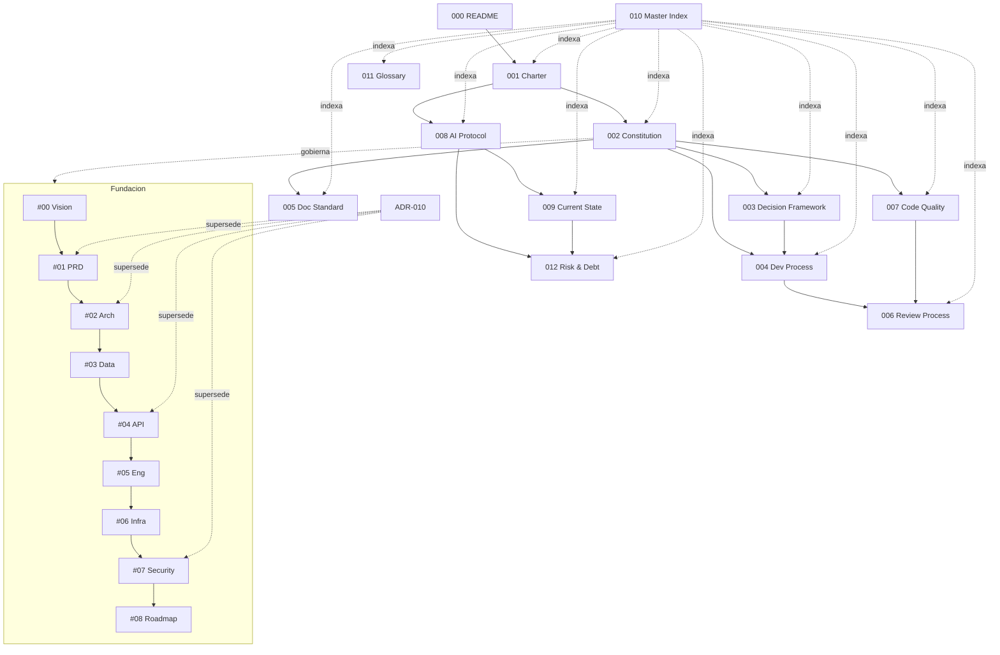

# 010 — Master Index

| Metadato | Valor |
|----------|-------|
| Versión | 1.1 |
| Estado | 🟢 Vigente |
| Ámbito | Mapa completo del conocimiento de mindOS y dueños de la verdad |
| Depende de | Toda la serie 000 y la cadena #00–#08 |
| Última actualización | 2026-10-27 |

## 1. Documentos de gobernanza (serie 000)
| # | Documento | Estado |
|---|-----------|--------|
| 000 | [README](./000_README.md) | 🟢 Vigente |
| 001 | [CPTO Charter](./001_CPTO_CHARTER.md) | 🟢 Vigente |
| 002 | [Engineering Constitution](./002_ENGINEERING_CONSTITUTION.md) | 🟢 Vigente |
| 003 | [Decision Framework](./003_DECISION_FRAMEWORK.md) | 🟢 Vigente |
| 004 | [Development Process](./004_DEVELOPMENT_PROCESS.md) | 🟢 Vigente |
| 005 | [Documentation Standard](./005_DOCUMENTATION_STANDARD.md) | 🟢 Vigente |
| 006 | [Review Process](./006_REVIEW_PROCESS.md) | 🟢 Vigente |
| 007 | [Code Quality](./007_CODE_QUALITY.md) | 🟢 Vigente |
| 008 | [AI Collaboration Protocol](./008_AI_COLLABORATION_PROTOCOL.md) | 🟢 Vigente |
| 009 | [Current State](./009_CURRENT_STATE.md) | 🟢 Vigente |
| 010 | [Master Index](./010_MASTER_INDEX.md) | 🟢 Vigente |
| 011 | [Glossary](./011_GLOSSARY.md) | 🟢 Vigente |
| 012 | [Risk & Debt Register](./012_RISK_AND_DEBT_REGISTER.md) | 🟢 Vigente |
| 013 | [Codebase Audit](./013_CODEBASE_AUDIT.md) | 🟢 Vigente (foto del 2026-07-10) |

## 2. Cadena de fundación (#00–#08)
| # | Documento | Estado |
|---|-----------|--------|
| 00 | [Vision & Problem Statement](../00-foundation/vision-and-problem-statement.md) | 🟢 Aprobado |
| 01 | [PRD](../01-product/prd.md) | 🟢 Aprobado (revisado por ADR-010) |
| 02 | [Technical Architecture](../02-architecture/technical-architecture.md) | 🟢 Aprobado (revisado por ADR-010) |
| 03 | [Data Architecture & Domain Model](../03-data/data-architecture-and-domain-model.md) | 🟢 Aprobado |
| 04 | [API Design Specification](../04-api/api-design-specification.md) | 🟢 Aprobado (revisado por ADR-010) |
| 05 | [Engineering Standards & Conventions](../05-engineering/engineering-standards-and-conventions.md) | 🟢 Aprobado |
| 06 | [Infrastructure & Deployment Strategy](../06-infrastructure/infrastructure-and-deployment-strategy.md) | 🟢 Aprobado |
| 07 | [Security & Privacy Framework](../07-security/security-and-privacy-framework.md) | 🟢 Aprobado (revisado por ADR-010) |
| 08 | [Roadmap Técnico](../08-roadmap/technical-roadmap.md) | 🟢 Aprobado (v0.5, estado de F0/F3 al día; R-004 mitigado) |

## 3. Architecture Decision Records
Todos los ADR (**ADR-001…ADR-020**) son archivos individuales en
[`../02-architecture/adr/`](../02-architecture/adr/README.md). El índice, con el
estado de cada uno, está en ese README. La consolidación D-004 está cerrada.

| ADR | Por qué importa hoy |
|-----|---------------------|
| [ADR-010](../02-architecture/adr/ADR-010-final-stack-and-two-backends.md) | Stack definitivo y dos backends |
| [ADR-012](../02-architecture/adr/ADR-012-canonical-stack.md) | Stack canónico (edge, objetos, colas) |
| [ADR-018](../02-architecture/adr/ADR-018-f2-comprehension-eval-gate.md) | Gate de calidad de la IA (no se relaja) |
| [ADR-019](../02-architecture/adr/ADR-019-queue-python-consumer-bridge.md) | Worker BullMQ en Python |
| [ADR-020](../02-architecture/adr/ADR-020-life-modules-as-note-nodes.md) | Tareas, Crecimiento y Finanzas como nodos `note` (retroactivo) |

## 3b. Documentos operativos y del agente
| Documento | Para qué |
|-----------|----------|
| [ESTADO_DEL_PROYECTO](../ESTADO_DEL_PROYECTO.md) | Estado en lenguaje simple para el founder |
| [DEPLOY_RENDER](../06-infrastructure/DEPLOY_RENDER.md) | Despliegue en Render + Neon y recuperación de fallos |
| [HOW_TO_RUN_THE_AI_EXAM](../HOW_TO_RUN_THE_AI_EXAM.md) · [`apps/ai/EVAL.md`](../../apps/ai/EVAL.md) | Cómo correr el examen de la IA |
| [`apps/api/TESTING.md`](../../apps/api/TESTING.md) | Tests de integración contra infra real |
| [`.kiro/specs/`](../../.kiro/specs/) | Specs de F1 (capture-engine) y F2 (comprehension) |
| [`.kiro/steering/mindos-context.md`](../../.kiro/steering/mindos-context.md) | Mapa del proyecto que el agente carga en cada sesión |
| [`.kiro/skills/`](../../.kiro/skills/) | Skills del agente (superpowers, impeccable, Emil Kowalski, taste, humanizer, caveman) |

## 4. Diagrama de dependencias

## 5. Dueño de la verdad por tema
| Tema | Autoridad |
|------|-----------|
| Visión y problema | [#00](../00-foundation/vision-and-problem-statement.md) |
| Requisitos de producto | [#01](../01-product/prd.md) |
| Arquitectura del sistema | [#02](../02-architecture/technical-architecture.md) + ADRs |
| Modelo de datos y grafo | [#03](../03-data/data-architecture-and-domain-model.md) |
| Contratos de API | [#04](../04-api/api-design-specification.md) (lo implementado: §5.0 y §5.7) |
| Estándares de ingeniería | [#05](../05-engineering/engineering-standards-and-conventions.md) + [007](./007_CODE_QUALITY.md) |
| Infraestructura y despliegue | [#06](../06-infrastructure/infrastructure-and-deployment-strategy.md) |
| Seguridad y privacidad | [#07](../07-security/security-and-privacy-framework.md) |
| Secuencia de construcción | [#08](../08-roadmap/technical-roadmap.md) |
| Decisiones estructurales | ADRs (`../02-architecture/adr/`) + [003](./003_DECISION_FRAMEWORK.md) |
| Estado actual del proyecto | [009](./009_CURRENT_STATE.md) (founder: [ESTADO_DEL_PROYECTO](../ESTADO_DEL_PROYECTO.md)) |
| Riesgos y deuda | [012](./012_RISK_AND_DEBT_REGISTER.md) |
| Lenguaje ubicuo | [011](./011_GLOSSARY.md) |

## 6. Orden de lectura recomendado
000 → 001 → 002 → 009 → 012 → 003 → 004 → 005 → 006 → 007 → 008 → 010 → 011, y en paralelo la cadena #00 → #08.

## Historial de versiones
| Versión | Fecha | Cambios |
|---------|-------|---------|
| 1.0 | 2026-07-02 | Índice maestro inicial: gobernanza, fundación, ADRs, dependencias y dueños de la verdad. |
| 1.1 | 2026-10-27 | Añadidos 013, el índice de ADR-001…020 (archivos individuales; D-004 cerrada), los documentos operativos y del agente (§3b) y la referencia a lo implementado en #04. El #08 deja de marcarse con deriva (R-004 mitigado). |
